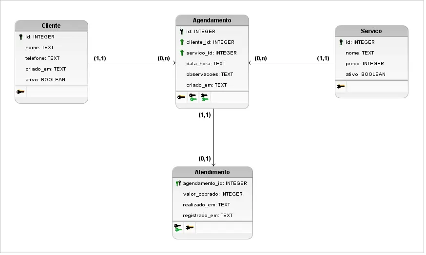

# Banco de dados

Para a persistência dos dados com um banco de dados local, utilizaremos o banco de dados [SQLite](https://sqlite.org/), realizando a implementação de acordo com a modelagem abaixo.

## Modelo Entidade-Relacionamento

Diagrama ER (modelo lógico) desenvolvido com a ferramenta **brModelo** ([https://www.sis4.com/](https://www.sis4.com/)).



### Comentários sobre a modelagem

- Os tipos dos dados foram definidos com base no uso do SQLite como banco de dados.

- Valores monetários serão representados em centavos, por isso a escolha do tipo de dado **INTEGER** para eles.

- A tabela **Atendimento** representará a realização de um agendamento. Ela conterá o valor cobrado para evitar que uma alteração no preço de um serviço também altere qual foi o valor cobrado em agendamentos antigos.

- Ainda na tabela **Atendimento**, sua chave primária será também a referência ao agendamento (chave estrangeira). Assim, haverá apenas um atendimento para cada agendamento realizado.

- A coluna **observacoes** na tabela **Agendamento** será um campo opcional.

- Números de telefone e datas (com horários) serão representados com o tipo **TEXT**, sendo que suas formatações serão abordadas na seção seguinte.

## Implementação

Para a implementação do banco de dados no aplicativo, utilizaremos o banco de dados SQLite (como citado acima) e a biblioteca [**sqflite**](https://pub.dev/packages/sqflite).

Será criado um componente específico que ficará responsável pela conexão, configuração e criação do banco de dados. Neste componente, será chamada a função `openDatabase` da biblioteca citada, passando informações como caminho (com o nome do arquivo `.db`), versão do banco de dados, configurações (como, por exemplo, ativar as chaves estrangeiras com `PRAGMA foreign_keys = ON`) e como serão criadas as suas tabelas.

Além deste componente, serão criadas classes que representarão as entidades (_models_) e os componentes responsáveis pelas operações com o banco de dados (_repositories_), separando a camada de acesso a dados.

### Formatação

Como citado nos comentários do diagrama, os valores monetários (`preco` e `valor_cobrado`) serão salvos em centavos no banco de dados.

Já para o campo `telefone` da tabela **Cliente**, iremos salvar apenas os dígitos, delegando para a aplicação a devida formatação na hora de apresentar ao usuário. Porém, o banco validará se são apenas dígitos e se o número de dígitos está no intervalo válido, baseado no padrão [ITU-T E.164](https://www.itu.int/rec/T-REC-E.164), que estabelece que um número de telefone válido nunca terá mais que 15 dígitos (utilizaremos o 7 como número mínimo, para descartar valores obviamente inválidos, mas sem restringir tanto).

Quanto aos campos de data e hora, utilizaremos o padrão [ISO 8601](https://www.iso8601.com/), no formato `2026-11-03T14:00:00.000Z`, sempre em UTC e com milissegundos. Ao consultar o dado, a aplicação converterá para o fuso horário local do usuário. Os campos que se referem ao momento em que um registro foi criado (`criado_em` e `registrado_em`) serão inseridos pelo próprio banco de dados.

### Criação das tabelas

Para a criação das tabelas, utilizaremos o _script_ SQL a seguir:

```sql
CREATE TABLE IF NOT EXISTS cliente (
    id          INTEGER PRIMARY KEY,
    nome        TEXT NOT NULL,
    telefone    TEXT NOT NULL
        CHECK (telefone NOT GLOB '*[^0-9]*' AND length(telefone) BETWEEN 7 AND 15),
    criado_em   TEXT NOT NULL DEFAULT (strftime('%Y-%m-%dT%H:%M:%fZ', 'now')),
    ativo       INTEGER NOT NULL DEFAULT 1 CHECK (ativo IN (0, 1))
);

CREATE TABLE IF NOT EXISTS servico (
    id      INTEGER PRIMARY KEY,
    nome    TEXT NOT NULL,
    preco   INTEGER NOT NULL CHECK (typeof(preco) = 'integer' AND preco >= 0),
    ativo   INTEGER NOT NULL DEFAULT 1 CHECK (ativo IN (0, 1))
);

CREATE TABLE IF NOT EXISTS agendamento (
    id          INTEGER PRIMARY KEY,
    cliente_id  INTEGER NOT NULL,
    servico_id  INTEGER NOT NULL,
    data_hora   TEXT NOT NULL
        CHECK (strftime('%Y-%m-%dT%H:%M:%fZ', data_hora) IS data_hora),
    observacoes TEXT,
    criado_em   TEXT NOT NULL DEFAULT (strftime('%Y-%m-%dT%H:%M:%fZ', 'now')),

    FOREIGN KEY (cliente_id) REFERENCES cliente(id)
        ON DELETE RESTRICT ON UPDATE CASCADE,
    FOREIGN KEY (servico_id) REFERENCES servico(id)
        ON DELETE RESTRICT ON UPDATE CASCADE
);

CREATE TABLE IF NOT EXISTS atendimento (
    agendamento_id  INTEGER PRIMARY KEY,
    valor_cobrado   INTEGER NOT NULL
        CHECK (typeof(valor_cobrado) = 'integer' AND valor_cobrado >= 0),
    realizado_em    TEXT NOT NULL
        CHECK (strftime('%Y-%m-%dT%H:%M:%fZ', realizado_em) IS realizado_em),
    registrado_em   TEXT NOT NULL DEFAULT (strftime('%Y-%m-%dT%H:%M:%fZ', 'now')),

    FOREIGN KEY (agendamento_id) REFERENCES agendamento(id)
        ON DELETE RESTRICT ON UPDATE CASCADE
);

CREATE INDEX IF NOT EXISTS idx_agendamento_cliente ON agendamento (cliente_id);
CREATE INDEX IF NOT EXISTS idx_agendamento_servico ON agendamento (servico_id);
CREATE INDEX IF NOT EXISTS idx_agendamento_data_hora ON agendamento (data_hora);
```
