# Wireframes em alta definição das telas

Foram elaborados protótipos das telas do **AgenDados**, aplicativo de gestão de agendamentos para profissionais e pequenos negócios. As telas foram planejadas com uma interface simples e intuitiva, para dispositivos Android, conforme os requisitos do projeto.

## Tela de agenda

Apresenta os agendamentos do período selecionado, com horário, cliente, serviço e situação do atendimento. Permite navegar entre datas e acessar o cadastro de um novo agendamento. O requisito também prevê consultas por dia, semana e mês, embora o protótipo mostre a visualização diária.

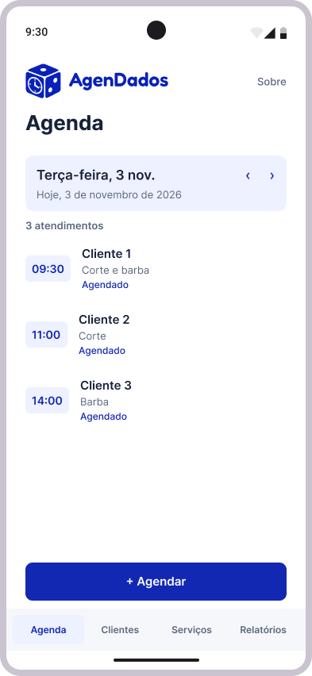

## Tela de novo agendamento

Permite selecionar o cliente, o serviço, a data e o horário, além de registrar observações opcionais. Exibe o valor previsto e um botão para salvar o agendamento.

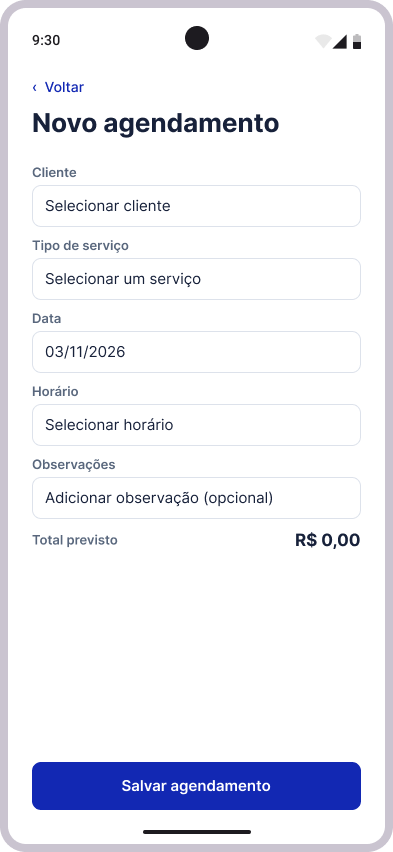

## Tela de detalhes do agendamento

Exibe as informações de um agendamento, incluindo cliente, horário, serviço, valor e observações. Disponibiliza ações para marcar o atendimento como realizado, editar ou cancelar.

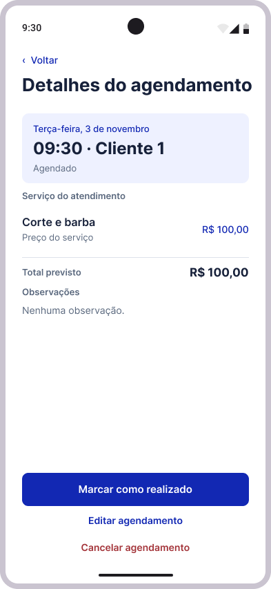

## Tela de clientes

Apresenta os clientes cadastrados, com campo de pesquisa por nome ou telefone e filtro de clientes ativos ou inativos. Permite acessar a ficha de um cliente e iniciar um novo cadastro.

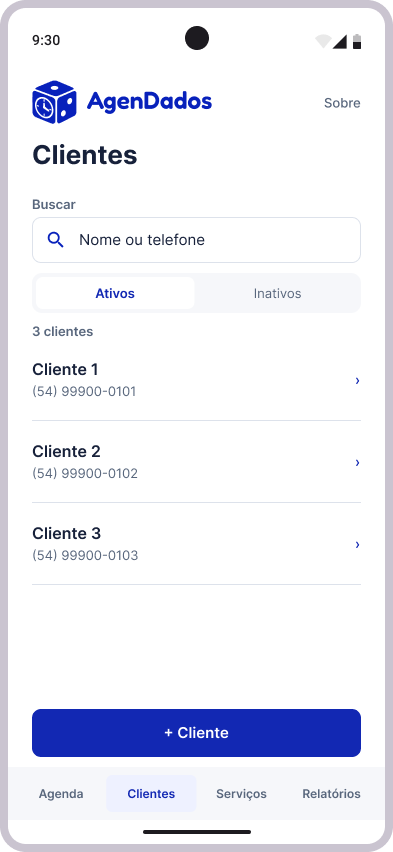

## Tela de cadastro de cliente

Permite cadastrar ou editar as informações básicas de um cliente, como nome e telefone. Inclui ações para salvar os dados ou desativar o cadastro.

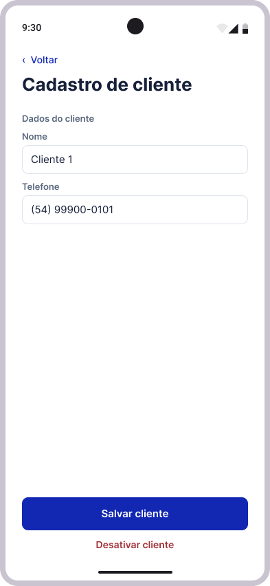

## Tela de ficha do cliente

Apresenta os dados do cliente e seu histórico de agendamentos, com datas, serviços, situações e valores. Permite editar o cadastro e criar um agendamento para esse cliente.

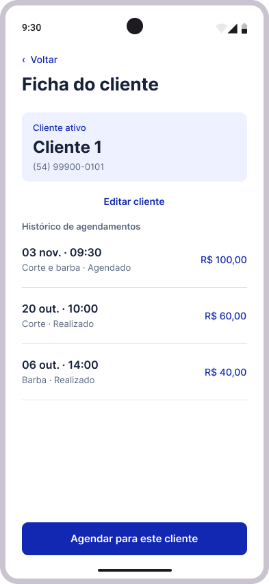

## Tela de serviços

Lista os serviços oferecidos pelo estabelecimento, com nome e preço. Possui pesquisa, filtros de serviços ativos e inativos e acesso ao cadastro de novos serviços.

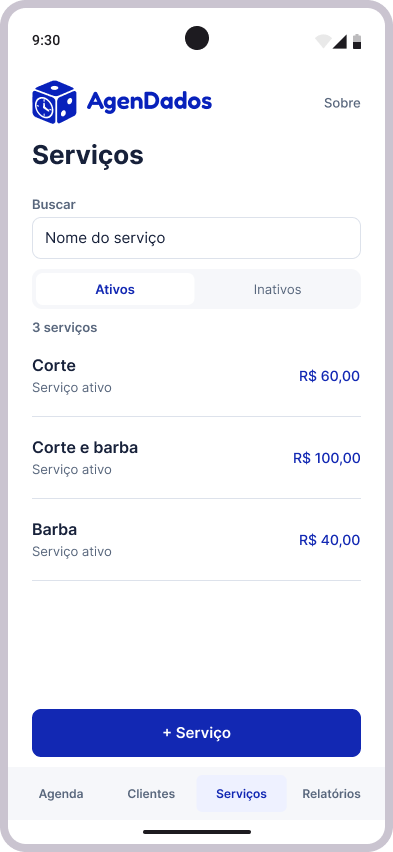

## Tela de cadastro de serviço

Permite cadastrar ou editar um serviço, informando nome e preço. Também oferece a opção de desativar o serviço.

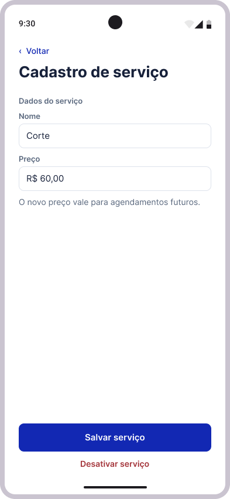

## Tela de relatórios de faturamento

Apresenta informações financeiras de um período selecionado, como o valor dos serviços realizados, total recebido e lista de atendimentos. Auxilia no acompanhamento do faturamento do estabelecimento.

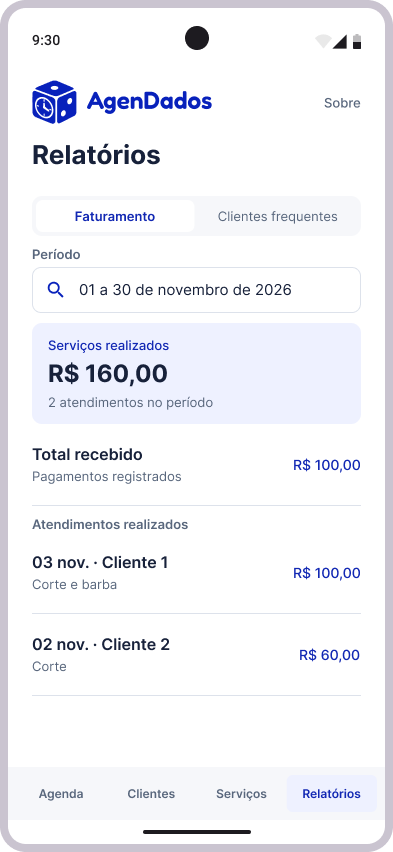

## Tela de relatório de clientes frequentes

Exibe os clientes que mais realizaram atendimentos no período selecionado, com quantidade de visitas e data da última visita. Facilita o acompanhamento da fidelização dos clientes.

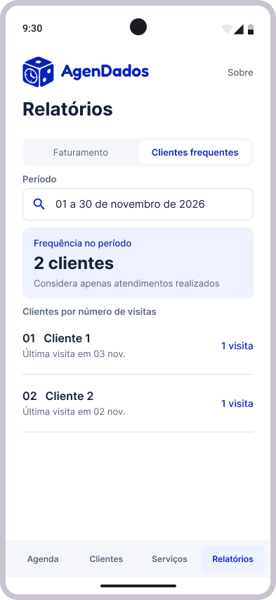

## Tela Sobre

Apresenta a identidade do AgenDados, uma breve descrição do aplicativo e os nomes dos integrantes da equipe responsável pelo desenvolvimento.

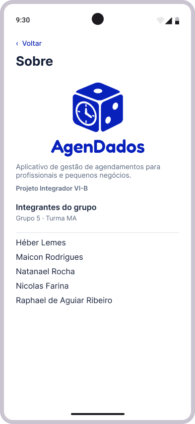

